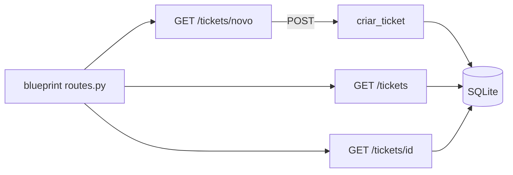

# portal-autoatendimento-helpdesk

**English** · [Português (Brasil)](README.md)

[](#) [](#) [](#) [](LICENSE)

## What it is

**A helpdesk self-service portal**: a **Flask app** where users open and track their own tickets — creation via form, listing and per-id detail. Data in **SQLite** via `sqlite3` (stdlib). It is an educational simple CRUD web-portal lab.

## Status

An educational lab, working and tested (5 tests).

## Features

- **Routes** (`routes.py`):
  - `GET /` — home page.
  - `GET /tickets` — lists tickets.
  - `GET/POST /tickets/novo` — creation form.
  - `GET /tickets/<id>` — ticket detail.
- **Model/persistence** (`models.py`): `Ticket` dataclass, `criar_ticket(tipo, descricao)`, `listar_tickets`, `obter_ticket`; `init_db` + `get_connection` (SQLite).
- **Flask blueprint** (`bp`) to organise routes.

## Architecture

A Flask app with a blueprint (`routes.py`) and a data layer in `models.py` (SQLite via stdlib). No authentication: anyone sees every ticket (lab).



## Stack

- Python ≥ 3.10
- Flask ≥ 3.0, < 4.0 (only dependency; SQLite via stdlib)
- pytest (dev)

## Repository layout

```
portal-autoatendimento-helpdesk/
├── pyproject.toml · BRIEF.md
├── src/portal_autoatendimento_helpdesk/
│   ├── routes.py   # routes blueprint
│   └── models.py   # Ticket + SQLite persistence
├── tests/          # 5 tests
└── LICENSE         # MIT
```

## Prerequisites and installation

```bash
pip install -e .
```

## How to run

```bash
flask --app portal_autoatendimento_helpdesk run
# or: python -m flask --app portal_autoatendimento_helpdesk.routes run
```

## Tests and quality

Real command (verified by the agent):

```bash
PYTHONPATH=src python -m pytest tests/
# 5 passed
```

## Technical decisions and trade-offs

- **SQLite via stdlib**: zero external services; the trade-off is no migrations/ORM.
- **Blueprint**: routes separated from app creation, easy to mount in another WSGI server.

## Known limitations and roadmap

- No user authentication/identification (everyone sees every ticket).
- No ticket closing/assignment (create, list and view only).

## Development process

An individual project by Kelvin Oliveira, built with orchestrated AI agents and reviewed by the author.

## License and author

MIT — Copyright (c) 2026 Kelvin Rebelo de Oliveira. Author: [Kelvin Oliveira](https://github.com/KelvinOliveiraCode) · [Portfolio](https://kelvinoliveiracode.github.io/portfolio/)
