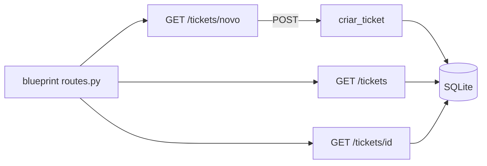

# portal-autoatendimento-helpdesk

[English](README.en.md) · **Português (Brasil)**

[](#) [](#) [](#) [](LICENSE)

## O que é

**Portal de autoatendimento de helpdesk**: uma **aplicação Flask** onde o usuário abre e acompanha seus próprios tickets — criação por formulário, listagem e detalhe por id. Dados em **SQLite** via `sqlite3` (stdlib). É um laboratório educacional de portal web simples com CRUD.

## Status

Laboratório educacional funcional e testado (5 testes).

## Funcionalidades

- **Rotas** (`routes.py`):
  - `GET /` — página inicial.
  - `GET /tickets` — lista tickets.
  - `GET/POST /tickets/novo` — formulário de criação.
  - `GET /tickets/<id>` — detalhe do ticket.
- **Modelo/persistência** (`models.py`): dataclass `Ticket`, `criar_ticket(tipo, descricao)`, `listar_tickets`, `obter_ticket`; `init_db` + `get_connection` (SQLite).
- **Blueprint** Flask (`bp`) para organizar as rotas.

## Arquitetura

App Flask com blueprint (`routes.py`) e camada de dados em `models.py` (SQLite via stdlib). Sem autenticação: qualquer usuário vê os tickets (lab).



## Stack

- Python ≥ 3.10
- Flask ≥ 3.0, < 4.0 (única dependência; SQLite via stdlib)
- pytest (dev)

## Estrutura do repositório

```
portal-autoatendimento-helpdesk/
├── pyproject.toml · BRIEF.md
├── src/portal_autoatendimento_helpdesk/
│   ├── routes.py   # blueprint com as rotas
│   └── models.py   # Ticket + persistência SQLite
├── tests/          # 5 testes
└── LICENSE         # MIT
```

## Pré-requisitos e instalação

```bash
pip install -e .
```

## Como executar

```bash
flask --app portal_autoatendimento_helpdesk run
# ou: python -m flask --app portal_autoatendimento_helpdesk.routes run
```

## Testes e qualidade

Comando real (verificado pelo agente):

```bash
PYTHONPATH=src python -m pytest tests/
# 5 passed
```

## Decisões técnicas e trade-offs

- **SQLite via stdlib**: zero serviços externos; em troca, sem migrações/ORM.
- **Blueprint**: rotas separadas da criação do app, fácil de montar em outro WSGI.

## Limitações conhecidas e roadmap

- Sem autenticação/identificação do usuário (todos veem todos os tickets).
- Sem fechamento/atribuição de tickets (só criar, listar e ver).

## Processo de desenvolvimento

Projeto individual de Kelvin Oliveira, construído com agentes de IA orquestrados e revisado pelo autor.

## Licença e autor

MIT — Copyright (c) 2026 Kelvin Rebelo de Oliveira. Autor: [Kelvin Oliveira](https://github.com/KelvinOliveiraCode) · [Portfólio](https://kelvinoliveiracode.github.io/portfolio/)
